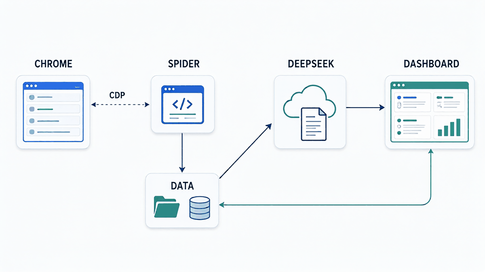

# AI 求职工作台（支持 Boss直聘）

> **本项目仅供个人学习、研究与技术交流使用；禁止商业用途、批量抓取、数据转售。**
> 非官方项目，与 Boss直聘无任何关联。使用前请阅读[完整免责声明](DISCLAIMER.md)，并遵守目标站点的用户协议与 robots.txt 及所在地法律法规。

基于 Chrome CDP（Chrome DevTools Protocol），在**你自己已登录**的 Chrome 上下文里读取职位列表与详情。项目同时集成 **AI 求职助手**：简历解析 → 职位匹配打分 → 推荐投递话术 → 市场分析报告 + 可视化面板。

## 免责声明

**本项目仅供个人学习、研究与技术交流使用，禁止任何商业用途、批量抓取和数据转售。**

- 本项目不构成对任何站点的授权，也不代表目标站点的立场。
- 使用者应自行遵守目标站点的用户协议、robots.txt 以及所在地法律法规；因使用本项目产生的任何后果由使用者自行承担。
- 本项目与 Boss直聘（北京华品博睿网络技术有限公司）无任何关联，未获其授权或认可；请勿使用其名称、Logo 进行商业宣传。
- 请勿将本项目用于绕过访问控制、验证码等机制。
- 项目按“现状”提供，不提供任何明示或暗示的担保。
- 如不同意上述条款，请立即停止使用并删除本项目。完整版本见 [DISCLAIMER.md](DISCLAIMER.md)。

## 隐私说明

- 爬取结果、简历、日志、Chrome 登录态默认保存在本机 `data/`，不会上传到本项目作者的服务器。
- **使用 AI 功能时**，简历结构化文本、职位描述会发送给你配置的模型服务（默认 DeepSeek）；请自行评估数据敏感性。
- API Key 保存在本机 `.env`，不会写入日志；请不要把 `.env`、`data/` 提交到仓库。
- 抓取结果可能包含 HR 姓名、公司地址等个人信息，请勿公开、转售或用于其他用途。

## 目录

- [免责声明](#免责声明)
- [完整免责声明（DISCLAIMER.md）](DISCLAIMER.md)
- [隐私说明](#隐私说明)
- [功能特性](#功能特性)
- [项目结构](#项目结构)
- [环境要求](#环境要求)
- [安装依赖](#安装依赖)
- [快速开始](#快速开始)
- [网页面板](#网页面板)
- [命令详解](#命令详解)
- [输出说明](#输出说明)
- [工作原理](#工作原理)
- [合规使用与频率控制](#合规使用与频率控制)
- [AI 求职助手](#ai-求职助手)
- [测试](#测试)
- [常见问题](#常见问题)
- [许可证](#许可证)

---

## 功能特性

**爬虫**

- **🆕 网页端爬取**：在面板里填表就能跑，实时进度条 + 日志流 + 一键停止（不用记命令）
- 通过 Chrome CDP 连接真实浏览器，携带完整登录态抓取数据
- 支持按关键词 + 城市搜索，内置 60+ 常用城市，可一键更新全国 374 个城市
- 列表数据：职位名称、薪资、地点、经验、学历、公司、技能、福利、HR 信息等
- 详情数据：真实打开详情页提取职位描述、详细地址，并补齐经验/学历
- **详情抓取可重试**：失败记录会自动重试（最多 3 次），空描述不会被误判成「已抓取」
- **跨页去重**：同一职位在多页重复出现会自动合并
- **断点续跑**：详情追加写入 `_detail_progress.jsonl`，中断不丢数据，下次自动跳过已完成项
- **Ctrl+C 安全退出**：手动中断也会把已抓到的数据落盘
- 慢速模式（`--slow`）：拉长请求间隔，降低反爬风险
- 支持 JSON / CSV 输出；文件名自动清洗（关键词含 `/`、`:` 等也不会出错）
- 出错不再静默：翻页被风控、详情页跳登录、职位下线都会明确提示原因

**AI 求职助手**

- 简历解析：PDF / Word（含 WPS 文本框）→ LLM 结构化 JSON，简历更新自动重解析
- AI 匹配打分：规则粗筛 + DeepSeek 精评（6 维度评分 + 理由 + 风险 + 话术要点）
- 推荐投递：TOP10 + 3 版本打招呼话术（简短/技能/项目）
- 市场分析：薪资分布 / 技能热词 / 城市对比 / 求职建议报告
- 可视化面板：FastAPI + ECharts（总览 / 职位 / 爬取 / 简历 / 匹配 / 报告 / 图表 / 设置）
- **全部操作都能在网页完成**：上传简历、跑匹配、生成话术、生成报告、改配置、清缓存，不用再记命令
- **成本可控**：缓存绑定「职位 + 简历版本」，简历不变重跑 0 花费；简历一改自动重新评分
- **用量可视**：每次调用记录 token 与估算成本（`data/ai_output/usage.jsonl`），设置页可看汇总
- 并发评分（默认 3 并发），50 个职位约 1 分钟出结果

## 项目结构

```
job-search-workbench/
├── common/                        # 公共模块（console/paths/salary/skills/text/chrome/cdp/log）
├── crawler/                       # 爬虫
│   ├── boss_cdp_spider.py         # 主爬虫（Chrome CDP，支持 --events 进度事件）
│   ├── fetch_cities.py            # 城市列表抓取
│   └── cities.py                  # 城市代码
├── ai/                            # AI 助手 + 面板
│   ├── run.py / dashboard.py      # 流程入口 / 面板后端
│   ├── crawl_service.py           # 网页任务管理（子进程/进度/日志/停止）
│   ├── templates/index.html       # 面板前端
│   └── resume_parser.py …         # 解析/粗筛/匹配/报告/话术/数据/配置/LLM
├── tests/                         # pytest（157 个用例）
├── assets/                        # README 图片
├── data/                          # 结果/AI 输出/日志/简历/登录态（已 gitignore）
├── run.py                         # 根入口
├── .env.example                   # 环境变量模板
├── requirements.txt / -dev.txt    # 运行 / 开发依赖
├── pytest.ini
├── LICENSE / DISCLAIMER.md        # MIT / 免责声明
├── .github/workflows/tests.yml    # CI
└── README.md
```

## 环境要求

- **操作系统**：Windows
- **Python**：3.10+（推荐 3.12；开发与测试使用 3.14）
- **Chrome 浏览器**：默认路径即可；装在别处时设置环境变量 `CHROME_PATH`
- **Boss直聘账号**：需手动登录一次

## 安装依赖

```bash
pip install -r requirements.txt
```

> 如果 pip 下载慢，可加国内镜像：`pip install -r requirements.txt -i https://pypi.tuna.tsinghua.edu.cn/simple`

## 快速开始

### 方式一：网页面板（推荐，点按钮就能爬）

```bash
python run.py dashboard
```

浏览器打开 `http://127.0.0.1:8000`，点顶部的「🕷️ 爬取」页：

1. 首次使用点「启动 Chrome 并登录」，在弹出的窗口里登录 Boss直聘
2. 填关键词、城市（可点常用城市快捷按钮）、页数、详情条数
3. 点「开始爬取」，右侧实时显示进度条和日志，随时可以「停止」
4. 跑完自动刷新「职位列表」；「最近运行」里可以下载本次的 JSON/CSV

> 面板同时包含总览 / 职位列表 / 分析图表 / 市场报告，爬完不用换窗口。

### 方式二：命令行（进阶 / 自动化）

```bash
# 检查环境（Chrome 路径 / 依赖 / CDP 端口）
python crawler\boss_cdp_spider.py --check

# 启动 Chrome 并登录（登录态保存在 data/boss_chrome_profile/）
python crawler\boss_cdp_spider.py --setup

# 爬取（结果保存到 data/boss_results/）
python crawler\boss_cdp_spider.py -k python -c 成都 -p 3
```

## 命令详解

```bash
python crawler\boss_cdp_spider.py -k <关键词> -c <城市> -p <页数> [-d 详情数] [-f json|csv] [--slow]
```

> 首次使用先运行 `--setup` 登录；登录态保存在 `data/boss_chrome_profile/`，不影响日常浏览器。

| 参数 | 简写 | 说明 | 默认值 |
|------|------|------|--------|
| `--keyword` | `-k` | 搜索关键词，如 `python`、`Java` | 必填 |
| `--city` | `-c` | 城市名称 / 城市代码 / 序号 | `全国` |
| `--pages` | `-p` | 爬取页数（每页 30 条） | `3` |
| `--detail` | `-d` | 本次抓取详情的条数 | `0`（不抓） |
| `--format` | `-f` | 输出格式：`json` / `csv` | `json` |
| `--slow` | | 慢速模式，拉长请求间隔 | 关闭 |
| `--cdp-port` | | Chrome 调试端口 | `9222` |
| `--login-wait` | | `--setup` 等待登录秒数 | `90` |
| `--out` | | 结果输出目录 | `data/boss_results` |
| `--debug` | | 输出调试信息（原始字段等） | 关闭 |

### 使用示例

```bash
# 成都 Python，爬 3 页
python crawler\boss_cdp_spider.py -k python -c 成都 -p 3

# 抓 5 条详情；慢速模式（已抓的自动跳过）
python crawler\boss_cdp_spider.py -k 前端 -c 北京 -p 2 -d 5 --slow

# 特殊字符关键词也能处理，输出 CSV
python crawler\boss_cdp_spider.py -k "C/C++" -c 成都 -p 1 -f csv
```

### 支持的城市

内置 60+ 常用城市（北京、上海、广州、深圳、杭州、成都…），`成都` / `成都市` / `成都·武侯区` 都能识别。

要支持官网全部 374 个城市：面板「爬取」页点「更新城市列表」，或运行 `python crawler\fetch_cities.py`（生成 `crawler/cities_full.json`）。

## 网页面板

`python run.py dashboard` 启动后（默认 `http://127.0.0.1:8000`）。界面是左侧固定导航 + 右侧内容区，
支持 `#jobs`、`#crawl` 这种 hash 直接打开某个页面；窗口变窄时导航会收拢成顶部一行。

| 页面 | 内容 |
|------|------|
| 总览 | 6 个指标 + 城市 / 学历 / 技能 / 经验四个图表 |
| 职位 | 全量职位表格，按分数、城市、关键词、学历筛选；点击行从右侧滑出详情 |
| 爬取 | 表单式爬取 + 实时进度 + 日志 + 停止 + 最近运行 |
| 简历 | 拖拽上传 PDF / Word / MD / TXT，自动解析并展示结构化结果 |
| 匹配推荐 | 跑 AI 匹配、看结果 Top8、生成 TOP10 与 3 版打招呼话术 |
| 市场报告 | 生成 / 查看 / 导出 report.md，数据比报告新时会提示「报告可能过期」 |
| 数据图表 | 薪资分布 / 技能排行 / 招聘公司 / 城市分布 |
| 设置 | 服务状态、API Key 与参数（写回 .env）、用量成本、缓存清理、数据目录 |

> 所有长任务（爬取、解析、匹配、话术、报告）都在页面底部的任务条里显示进度，
> 可以随时「停止」并展开日志；关掉页面任务也会继续跑，回来还能接着看。

### 为什么都放在网页里

从「简历」上传解析，到「匹配推荐」跑分、生成 TOP10 话术，再到「市场报告」出报告，全在同一个界面；Key / 模型 / 推荐线在「设置」里改，保存即写回 `.env`。

### 爬取页能做什么

- **参数**：关键词、城市（全量 374 城市可搜索 + 24 个常用城市快捷按钮）、页数、详情条数、JSON/CSV、慢速模式
- **实时进度**：搜索阶段显示「列表第 2/3 页」，详情阶段显示「详情 4/10：职位名」；总进度按「列表 50% + 详情 50%」折算
- **日志流**：每秒拉取增量日志，错误红色、警告黄色；关掉页面/刷新不影响后台任务
- **停止**：结束爬虫子进程；已抓到的详情已经写入断点，不会丢
- **最近运行**：读取 `data/logs/run_history.jsonl`，显示时间/关键词/城市/职位数/详情数/成功失败，可下载结果文件
- **环境提示**：检测 Chrome 是否可定位、9222 端口是否就绪；未就绪时直接给「启动 Chrome 并登录」按钮

### 相关接口

| 方法 | 路径 | 说明 |
|------|------|------|
| GET | `/api/cities` | 常用城市 + 全量城市 |
| GET | `/api/crawl/env` | Chrome / CDP 端口状态 |
| GET/POST | `/api/tasks/*` | 启动 / 停止 / 查询任务（kind: crawl/setup/cities/parse/match/report/top10） |
| GET | `/api/crawl/history` | 最近运行记录（含 AI 任务） |
| GET | `/api/crawl/result?name=...` | 下载爬取结果文件 |
| GET/POST | `/api/resume/*` | 简历列表 / 上传（10MB 上限） |
| GET | `/api/top10` | 推荐话术（markdown + html） |
| GET/POST | `/api/settings` | 读取 / 写回 `.env`（Key 只回传掩码） |
| POST | `/api/cache/clear` | 清理匹配/话术缓存、详情断点 |
| GET | `/api/usage` | token 与成本汇总 |

## 输出说明

### JSON 格式

文件：`data/boss_results/boss_{城市}_{关键词}_{时间戳}.json`

```json
[{"job_id": "...", "job_name": "Python开发工程师", "company_name": "XX科技",
  "salary": "10-15K", "location": "成都 武侯区", "experience": "3-5年",
  "education": "本科", "skills": "Python, Django", "hr_name": "张女士", "job_url": "..."}]
```

### 字段说明

| 字段 | 说明 | 来源 |
|------|------|------|
| `job_id` | 职位加密 ID | 列表 API |
| `salary_min` / `salary_max` | 薪资区间（K/月，解析失败为空） | 本地解析 |
| `location` | 工作地点 | 列表 API |
| `experience` / `education` | 经验 / 学历 | 列表 API + 详情页补充 |
| `skills` / `job_labels` / `welfare` | 技能 / 标签 / 福利 | 列表 API |
| `hr_name` / `hr_title` | HR 姓名 / 职位 | 列表 API |
| `job_description` | 职位描述 | 详情页提取（优先）/ 详情 API（降级） |
| `job_address` | 详细地址 | 同上 |
| `job_url` | 职位详情链接 | 本地拼接 |

> **注意**：`job_description` / `job_address` 需要 `--detail N` 才会填充。详情受反爬限制，建议配合 `--slow`、一次 5~10 条。已抓的详情写在 `data/boss_results/_detail_progress.jsonl`（追加写，中断不丢），重复运行自动续抓；失败的会在下次运行自动重试。

### 日志

运行日志写入 `data/logs/crawler.log`（滚动，最大 2MB × 3），控制台输出保持原样。

## 工作原理



Chrome（已登录）通过 CDP 把页面交给爬虫，爬虫把列表/详情写入 `data/`；AI 读职位与简历调用 DeepSeek，产出匹配分、报告和话术；面板读取 `data/` 展示结果。

核心优势：真实浏览器环境（完整登录态）、不注入自动化特征、详情走真实页面。

## 合规使用与频率控制

> 本项目不提供验证码破解、代理池或浏览器指纹伪造。是否使用、如何使用由使用者自行判断并承担风险。

Boss直聘的 [robots.txt](https://www.zhipin.com/robots.txt) 对搜索与详情等路径有明确限制，例如：

```
Disallow: /web/boss/*
Disallow: /*?*
Disallow: /*?query=*
Disallow: /job_detail/l*.html
```

爬虫的搜索入口 `/web/geek/job?query=...&city=...` 正好落在这些规则里。**请先阅读并遵守目标站点的用户协议与 robots.txt；如果条款不允许自动化访问，请不要使用爬取功能。**

项目内置的节流手段（目的是减轻对站点的压力，不是绕过限制）：

- 默认随机延迟，`--slow` 进一步拉长
- 详情优先打开页面提取，失败才回退接口
- 失败指数退避；遇到风控码或连续失败立即停止
- 用 `--pages` / `--detail` 控制规模，建议只抓自己需要的职位

### 详情获取策略

1. **优先**：导航到 `job_detail/{id}.html`，等待 `.job-sec-text` 渲染后提取
2. **判定成功**：必须拿到 ≥20 字的职位描述；否则记为失败（**不会**被缓存成已完成）
3. **降级**：页面失败时回退详情 API
4. **自动重试**：失败记录带 `attempts`，下次运行最多再试 3 次
5. **风控保护**：遇到 code 37 立即停止；连续失败 5 次停止，避免把封禁刷得更狠

## AI 求职助手

基于 DeepSeek API 的简历匹配与投递优化工具。

### 配置

复制 `.env.example` 为 `.env` 并填入 `DEEPSEEK_API_KEY`（已被 gitignore）。还可以调：

| 变量 | 默认 | 说明 |
|------|------|------|
| `MATCH_THRESHOLD` | 70 | 推荐线，低于此分不进 TOP10 |
| `MAX_CANDIDATES` | 50 | AI 精评候选上限（控制花费） |
| `LLM_CONCURRENCY` | 3 | 并发调用数 |
| `SKILL_WEIGHT` 等 6 项 | 0.30/0.20/0.15/0.15/0.10/0.10 | 维度权重（自动归一化，会写入 prompt） |
| `DEEPSEEK_PRICE_IN` / `OUT` | 2.0 / 8.0 | 元/百万 token，用于成本估算 |

### 使用流程

```bash
# ① 解析简历（PDF / Word / Markdown / txt；简历改了会自动重新解析）
python run.py parse -f resume.docx

# ② 爬取职位（也可先手动跑爬虫）
python run.py crawl -k java -c 成都 -p 2 --slow -d 10

# ③ 规则粗筛 + AI 精评
python run.py match                 # 默认合并 data/boss_results/ 全部结果
python run.py match --latest        # 只匹配最新一次爬取
python run.py match --file xxx.json # 指定文件
python run.py match -n 30 -j 5      # 候选上限 30、5 并发

# ④ 市场分析报告
python run.py report

# ⑤ 推荐投递 TOP10 + 3 版话术
python run.py top10

# 一键全流程
python run.py all -f resume.docx -k java -c 成都 -p 2 --slow -d 10
python run.py all -f 简历.docx -k java --no-crawl    # 跳过爬取，用已有数据
```

### 输出文件（`data/ai_output/`）

| 文件 | 内容 |
|------|------|
| `resume_structured.json` | 简历结构化结果 |
| `matched_jobs.json` | 全部职位匹配分（含各维度分/理由/风险） |
| `top10.md` | 推荐投递 TOP10 + 3 版话术 |
| `report.md` | 市场分析报告 |
| `match_cache.json` | 匹配缓存（绑定简历版本） |
| `letter_cache.json` | 话术缓存 |
| `usage.jsonl` | 每次运行的 token 用量与估算成本 |

### 成本与缓存

- 50 个职位 AI 精评 ≈ ¥1-2（DeepSeek），并发 3 时约 1 分钟
- 缓存键 = `job_id + 简历指纹 + 缓存版本`：
  - 简历没变 → 重跑 0 花费
  - **简历改了 → 自动全部重评**（旧版这里会错误复用旧分数）
- 每次运行结束会打印本次 token 与估算成本

面板见 [网页面板](#网页面板)；数据实时读取 `data/boss_results/` 与 `data/ai_output/`，刷新即可看到。

## 测试

```bash
pip install -r requirements-dev.txt
python -m pytest
```

覆盖范围（157 个用例）：

- **解析与清洗**：薪资、城市、经验/学历、技能、脏分数、文件名安全
- **数据与缓存**：多文件合并去重、坏文件容错、缓存键与旧缓存失效
- **爬虫与 CDP**：字段映射、逐页抓取、断点 JSONL、超时/异常处理
- **任务与面板**：参数校验、子进程启停、`.env` 写回、上传与接口

## 常见问题

### Q: 提示“连接 CDP 失败”/“调试端口未就绪”

先运行 `--setup`。如果 Chrome 已经开着，多半是同一个 profile 被占用且没开调试端口 —— 关闭所有 Chrome 窗口后重试。

### Q: 提示“您的环境存在异常”（code 37）

Cookie 过期或触发风控：

1. 重新运行 `--setup` 登录
2. 减少页数 / 详情数，加 `--slow`
3. 隔 10-30 分钟再跑（已抓的会自动跳过）

### Q: 详情获取失败

会提示原因（跳登录 / 风控 / 职位下线 / 页面结构变化）；失败记录带 `attempts`，下次自动重试。日志见 `data/logs/crawler.log`。

### Q: Chrome 不在默认路径

设置 `CHROME_PATH` 即可，不用改代码：

```bash
set CHROME_PATH=D:\Chrome\chrome.exe
```

### Q: 修改简历后分数没变

现在不会了。缓存键包含简历指纹，简历一改自动全部重评。如果你想强制清空：

```bash
del data\ai_output\match_cache.json
python run.py match
```

### Q: 设置页出现 `undefined` / 按钮没反应

前后端版本不一致（浏览器是新页面、进程是旧后端）。按页面顶部红条提示重启 `python run.py dashboard`，再刷新即可。

### Q: 匹配分在哪里跑

职位页「AI 匹配」按钮（默认参数），或「匹配推荐」页（可调候选上限 / 并发，跑完看 Top8 并生成话术）。

### Q: 如何切换 Boss 账号

```bash
rmdir /s /q data\boss_chrome_profile
python crawler\boss_cdp_spider.py --setup
```

### Q: 数据会不会被提交到 git

不会。`.gitignore` 直接忽略整个 `data/`（含登录态、简历、抓取结果、日志），以及 `.env`、`cities_full.json`。

## 许可证

[MIT](LICENSE) © 2026 Menorial

第三方组件：ECharts（Apache-2.0）、FastAPI（MIT）、uvicorn（BSD）、OpenAI Python SDK（Apache-2.0）等，分别遵循各自许可证。
